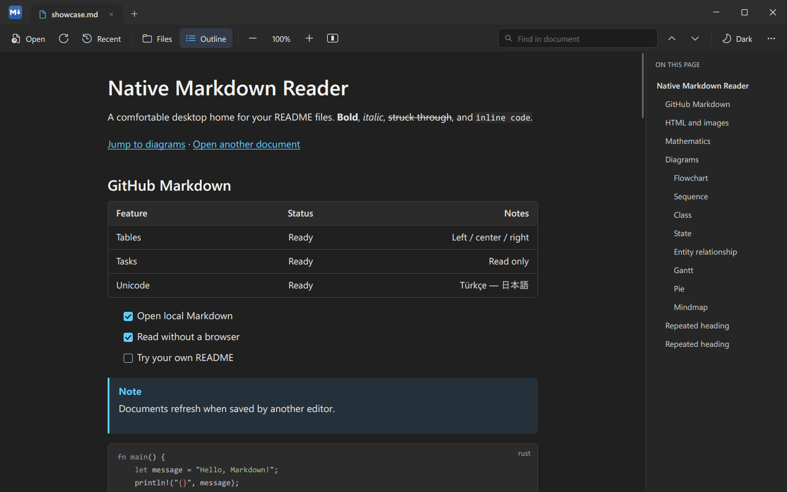
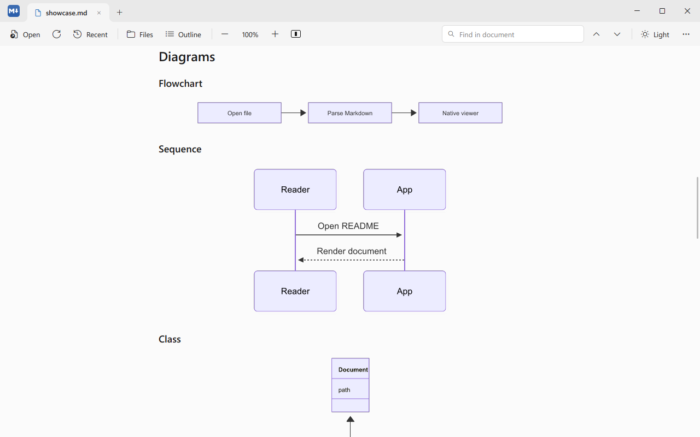

# mdview


A Markdown viewer for Windows and Linux with its own renderer. No webview and no browser engine: the page,
the tabs, the menus and every other control are drawn by the program itself, in Rust.

It opens quickly, stays small in memory, and aims to show a document the way GitHub would.





## What it does

- **GitHub-flavoured Markdown:** tables, task lists, footnotes, alerts, strikethrough, autolinks,
  front matter, emoji shortcodes, and the HTML that GitHub allows (`<details>`, `<kbd>`, `<sub>`,
  aligned blocks, HTML tables with spans, `<picture>` with light and dark sources).
- **Math and diagrams:** TeX math (`$...$`, `$$...$$`, fenced `math`) and Mermaid, 31 diagram
  families, rendered locally.
- **Syntax highlighting** in fenced code blocks.
- **Images:** PNG, JPEG, GIF, WebP and SVG. Remote images stay off until you allow them, per
  document or always.
- **Updates:** an installed mdview (on Linux, the AppImage) looks for a newer version at every
  launch and asks before it downloads anything. Settings and About turn the look off.
- **Reading:** tabs, a Files pane, an Outline pane, find, zoom, light and dark themes, a focus
  mode, three page widths, back and forward, session restore, and reload when the file changes on
  disk, keeping your place.
- **The outline follows the page:** the heading of the section at the top of the window is
  highlighted and its row is kept in view; the list stays put while the pointer is on it.
- **Back and Forward.** Following a link to another file or to an anchor, a footnote, an outline
  or palette heading, or a backlink remembers where you were; Alt+Left / Alt+Right (or the mouse's
  Back / Forward buttons, or the command palette) return there at the exact scroll position.
- **Copy keeps the formatting.** Copying a selection (Ctrl+C or Copy in the context menu) puts
  plain text and HTML on the clipboard together, so a paste into a word processor or a mail keeps
  headings, emphasis, links, lists, tables and code, and a paste into a text field gets the plain
  text as before.
- **Copy button on code blocks.** Point at a code block and a small copy button appears at its top
  right; a click copies the block's code exactly (without the newline that ends its last line) and
  the button shows a check mark for a moment. "Copy code block" in the command palette copies the
  block the selection starts in, else the first code block in view.
- **Hover previews.** Rest the pointer on a footnote mark and a small card shows the footnote's
  text; on a link to a heading of the same page, the heading and the first lines under it; on a
  link to another local Markdown file, its title and first lines. Web addresses keep their hint at
  the bottom left. Settings > "Preview footnotes and links on hover" turns the cards off.
- **Find in folder** searches the Markdown files of the open folder for a text and lists the
  matching lines by file, with the match marked. Enter or a click opens the file at the match,
  highlighted as the find in the page does. It runs on a background thread, results stream in,
  and Escape or a new query cancels it. It is in the "⋯" menu and the command palette
  (`>find in folder`); it has no key yet.
- **Export as HTML** saves the open document as one self-contained `.html` file (the page's
  light look, your page font and width, code colours, tables, task boxes, footnotes, formulas and
  diagrams as pictures, local images embedded). **Print (opens in browser)** opens a printable
  copy in the default browser, which shows its own print dialog. Both are in a tab's context menu
  and the command palette (`>export`, `>print`).
- **Command palette (Ctrl+P):** open tabs, recent files, the open folder's Markdown files,
  commands (`>`) and headings (`#`).
- **Settings (Ctrl+,):** page width, text size, theme, a page font and a code font (any installed
  family), remote images, ticking task boxes, animations, and updates.
- **Window:** rounded corners (Settings > Window corners: Square, Small or Round; Round, 8 px at
  100 %, is the default). Windows 11 draws them itself; on Wayland the window draws its own shape
  and shadow; where the window is opaque (X11, KDE with a square setting) it stays square.
- **With mdedit:** Edit in mdedit (Ctrl+E) opens the file in the editor at the line you are
  reading, and when mdedit previews a file here it shows the editor's unsaved text as you type
  (live preview, up to 2 MiB) and returns to the saved file when the editor closes.
- **Task boxes can be ticked.** A click flips `[ ]` and `[x]` in the file, after asking once.
  Nothing else in a document is ever written.

[docs/COVERAGE.md](docs/COVERAGE.md) lists what is supported feature by feature, and what is not.

## Numbers

Measured on one Windows 11 PC, release build, on 2026-11-12:

| | |
|---|---|
| First frame on launch | 63 to 98 ms |
| Private memory, a small document | 24 MiB |
| Private memory, a 1 MiB document | 34 MiB |
| `mdview.exe` | 7.5 MB |
| Idle CPU | none |

These were not measured again on Windows for 0.3.0; `mdview.exe` was about 8.4 MB at 0.2.3. On
Linux (KDE Plasma, 2026-11-14) the first frame took 78 to 85 ms.

Math, diagrams and SVG are drawn by a separate helper process, `mdview-engine`, which starts when
a document needs it and exits when idle, so a malformed document cannot take the viewer down.

## Status

A personal project, usable every day on Windows 11. Version 0.3.0 is on the
[releases page](https://github.com/Kaan88/markdown-viewer-rs/releases/latest) for Windows (with its
installer) and, for the first time, Linux; nothing is code-signed. The release files are built by
GitHub Actions, Windows natively on a Windows runner. On 2026-11-14 the full test suite and every
screenshot state ran on a real Windows runner; nobody has yet used 0.3.0 by hand on a Windows
desktop. Linux has run on KDE Plasma 6 (Wayland) and, headless, on sway; GNOME and other desktops
have not been tried.

Known gaps are listed in [docs/HANDOFF.md](docs/HANDOFF.md), section 11. The larger one: tables
always fill the page column.

## Download

The releases page has:

- **Windows:**
  - `mdview-setup-<version>.exe`: the installer, per user. It registers the Markdown extensions
    under "Open with" and never takes the `.md` default. Pick this for a normal install.
  - `mdview.exe` together with `mdview-engine.exe`, kept in one folder: the bare executables.
  - `mdview-<version>-windows-x86_64.zip`: the same two executables with LICENSE and README.md in
    a folder, for a portable copy.
  - None is code-signed.
- **Linux** (x86-64):
  - `mdview-<version>-linux-x86_64.AppImage`: any distribution, no root. Make it executable and
    run it: `chmod +x mdview-*.AppImage && ./mdview-*.AppImage`. The engine is inside it.
  - `mdview_<version>_amd64.deb` for Debian 11+, Ubuntu 20.04+ and derivatives, and
    `mdview-<version>-1.x86_64.rpm` for Fedora, openSUSE and RHEL: pick one with a package manager.
  - `PKGBUILD` for Arch: in a folder holding it, `makepkg -si` installs the tar.gz as `mdview-bin`.
  - `mdview-<version>-linux-x86_64.tar.gz`: `install.sh [PREFIX]` (default `~/.local`) and
    `uninstall.sh`, on any distribution.
- `mdview-update.txt` is the manifest the updater reads.

The Windows installed copy, the bare exes and the portable zip's exes update themselves (the
folder must be writable), and so does the AppImage. The deb, rpm, tar.gz and Arch installs do not;
the app says only the AppImage can update itself. They install a desktop file, so the taskbar icon
and "Open with" work without the AppImage's first-run registration.

The AppImage is built in an Ubuntu 20.04 container, so it needs glibc 2.31 or later. It needs the
system's libc, fontconfig, freetype and the X11/xcb libraries, and loads libcurl and the Wayland
libraries at run time. On first run it writes its desktop entry and icon into your data folder and
registers its file types so mdview shows under "Open with"; it does not take any default. "Make
mdview the default" is a command in Settings and in the command palette. To remove it, delete the
AppImage, the entry it wrote under `~/.local/share/applications` and the icon under
`~/.local/share/icons/hicolor/256x256/apps`.

## Build

You need Rust (1.99 was used) and, on Windows, the MSVC build tools; on Linux a C toolchain and the
fontconfig, freetype and X11/xcb development packages.

```powershell
cargo build --release --workspace
cargo test --release --workspace
```

This gives `target\release\mdview.exe` and `target\release\mdview-engine.exe`; keep them together
(on Linux `target/release/mdview` and `target/release/mdview-engine`). Releases are cut by
pushing a tag `v<version>`: GitHub Actions builds and publishes the files above. See `docs/CI.md`;
`docs/UPDATE.md` has the local scripts for a dry run.

```powershell
target\release\mdview.exe README.md
```

To build the installer (needs Inno Setup 7):

```powershell
packaging\windows\build-installer.ps1
```

It installs per user, registers the Markdown extensions as an "Open with" choice, and never takes
the `.md` default.

## Keys

| | |
|---|---|
| Open files, open folder | Ctrl+O, Ctrl+Shift+O |
| Reload | F5 |
| Edit in mdedit (the file, at the place being read) | Ctrl+E |
| Close tab, close all | Ctrl+W, Ctrl+Shift+W |
| Find, next, previous | Ctrl+F, F3, Shift+F3 |
| Zoom in, out, reset | Ctrl++, Ctrl+-, Ctrl+0 |
| Files pane, Outline pane | Ctrl+Shift+1, Ctrl+Shift+2 |
| Focus reading mode | Ctrl+Shift+F |
| Command palette | Ctrl+P, Ctrl+Shift+P |
| Settings | Ctrl+, |
| Next tab, previous tab | Ctrl+Tab, Ctrl+Shift+Tab |
| Back, forward | Alt+Left, Alt+Right |

The full list is in the app under "Keyboard shortcuts".

## Layout of the repository

| Path | What it is |
|---|---|
| `crates/core` | Parser, document model, find, session, file watching |
| `crates/render` | The headless renderer: layout, text, images, hit testing |
| `crates/engine` | The helper process: SVG, TeX math, Mermaid |
| `bins/mdv-app` | The application, binary `mdview` |
| `bins/mdv-bench` | Headless renders, timings and golden images |
| `docs/` | The plan, the current state, and the coverage list |

[docs/HANDOFF.md](docs/HANDOFF.md) describes the current state in detail and
[docs/PLAN.md](docs/PLAN.md) the plan.

## Related

- [markdown-editor-rs](https://github.com/Kaan88/markdown-editor-rs): `mdedit`, a text
  editor with the same interface, for Windows and Linux. The two open each other's files.
- [markdown-shared-rs](https://github.com/Kaan88/markdown-shared-rs): the painter, widgets, text
  engine, highlighting, downloads and the updater both use. This repository pins a commit of it.


## Licence

[MIT](LICENSE).
