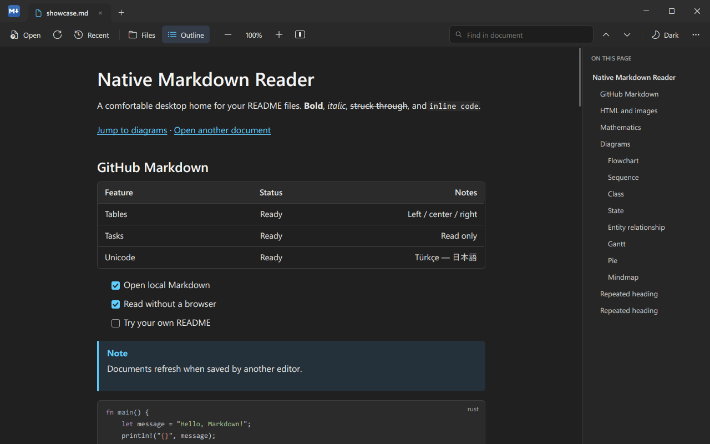
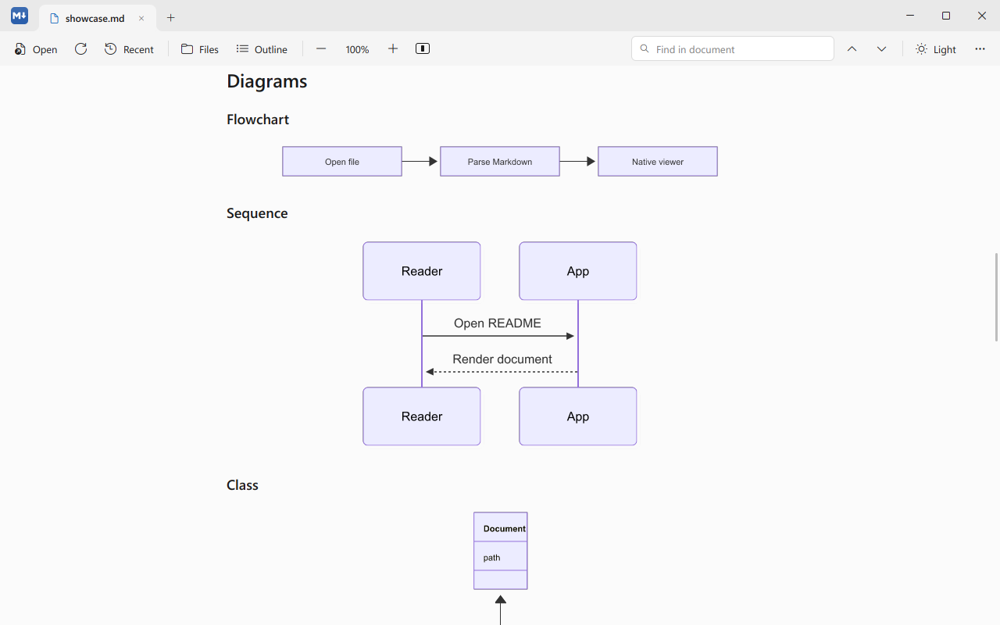

# mdview


A Markdown viewer for Windows with its own renderer. No webview and no browser engine: the page,
the tabs, the menus and every other control are drawn by the program itself, in Rust.

It opens quickly, stays small in memory, and aims to show a document the way GitHub would.





## What it does

- **GitHub-flavoured Markdown:** tables, task lists, footnotes, alerts, strikethrough, autolinks,
  front matter, emoji shortcodes, and the HTML that GitHub allows (`<details>`, `<kbd>`, `<sub>`,
  aligned blocks, HTML tables with spans, `<picture>` with light and dark sources).
- **Math and diagrams:** TeX math (`$...$`, `$$...$$`, fenced `math`) and Mermaid, 31 diagram
  families, rendered locally.
- **Syntax highlighting** in fenced code blocks.
- **Images:** PNG, JPEG, GIF, WebP and SVG. Remote images stay off until you allow them, per
  document or always.
- **Reading:** tabs, a Files pane, an Outline pane, find, zoom, light and dark themes, a focus
  mode, three page widths, back and forward, session restore, and reload when the file changes on
  disk, keeping your place.
- **Task boxes can be ticked.** A click flips `[ ]` and `[x]` in the file, after asking once.
  Nothing else in a document is ever written.

[docs/COVERAGE.md](docs/COVERAGE.md) lists what is supported feature by feature, and what is not.

## Numbers

Measured on one Windows 11 PC, release build, on 2026-11-12:

| | |
|---|---|
| First frame on launch | 63 to 98 ms |
| Private memory, a small document | 24 MiB |
| Private memory, a 1 MiB document | 34 MiB |
| `mdview.exe` | 7.5 MB |
| Idle CPU | none |

Math, diagrams and SVG are drawn by a separate helper process, `mdview-engine`, which starts when
a document needs it and exits when idle, so a malformed document cannot take the viewer down.

## Status

A personal project, usable every day on Windows 11, and still a pre-release: version 0.1.0, no
published installer, no code signing. It has been built and run on one PC. Linux is planned and
not done for this shell.

Known gaps are listed in [docs/HANDOFF.md](docs/HANDOFF.md), section 11. The larger ones: tables
always fill the page column, GIFs show their first frame, and Kotlin, Swift, PowerShell and
Dockerfile blocks are not highlighted.

## Build

You need Rust (1.99 was used) and the MSVC build tools.

```powershell
cargo build --release --workspace
cargo test --release --workspace
```

This gives `target\release\mdview.exe` and `target\release\mdview-engine.exe`; keep them together.

```powershell
target\release\mdview.exe README.md
```

To build the installer (needs Inno Setup 7):

```powershell
packaging\windows\build-installer.ps1
```

It installs per user, registers the Markdown extensions as an "Open with" choice, and never takes
the `.md` default.

## Keys

| | |
|---|---|
| Open files, open folder | Ctrl+O, Ctrl+Shift+O |
| Reload | F5 |
| Close tab, close all | Ctrl+W, Ctrl+Shift+W |
| Find | Ctrl+F |
| Zoom in, out, reset | Ctrl++, Ctrl+-, Ctrl+0 |
| Files pane, Outline pane | Ctrl+Shift+1, Ctrl+Shift+2 |
| Focus reading mode | Ctrl+Shift+F |
| Back, forward | Alt+Left, Alt+Right |

The full list is in the app under "Keyboard shortcuts".

## Layout of the repository

| Path | What it is |
|---|---|
| `crates/core` | Parser, document model, find, session, file watching |
| `crates/render` | The headless renderer: layout, text, images, hit testing |
| `crates/engine` | The helper process: SVG, TeX math, Mermaid |
| `crates/fetch` | Remote image downloads and their cache |
| `bins/mdv-app` | The application, binary `mdview` |
| `bins/mdv-bench` | Headless renders, timings and golden images |
| `docs/` | The plan, the current state, and the coverage list |

[docs/HANDOFF.md](docs/HANDOFF.md) describes the current state in detail and
[docs/PLAN.md](docs/PLAN.md) the plan.

## Related

- [markdown-editor-rs](https://github.com/Kaan88/markdown-editor-rs): `mdedit`, a text
  editor with the same interface.
- [markdown-shared-rs](https://github.com/Kaan88/markdown-shared-rs): the painter, widgets, text
  engine and highlighting both use. This repository pins a commit of it.

The editor is at its first, read-only phase.

## Licence

[MIT](LICENSE).
