# More Mermaid diagrams

One sample of each family beyond the eight in `diagrams.md`. Every one draws as an image; the last section shows a family that stays disabled and falls back to its source.

## Timeline

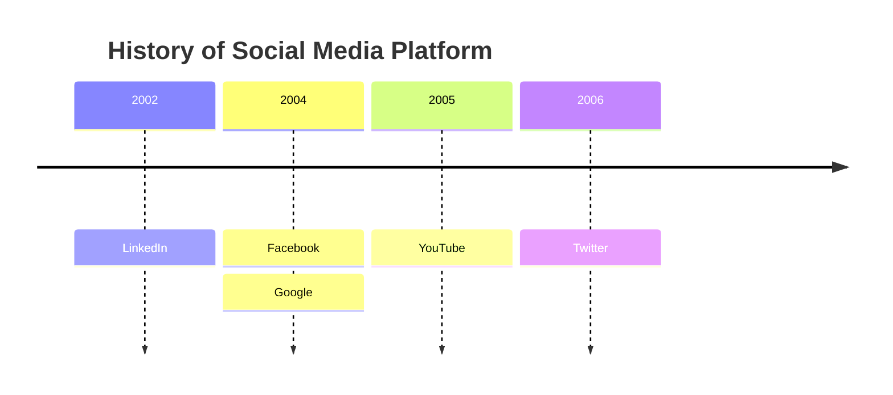

## User journey

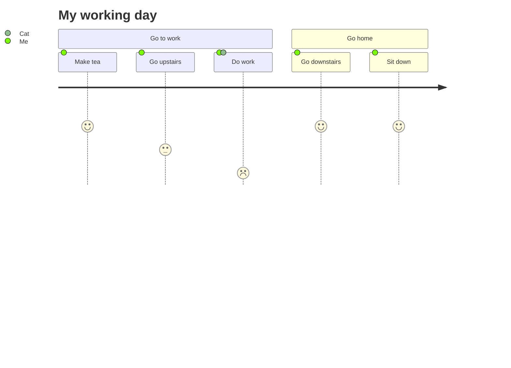

## Git graph

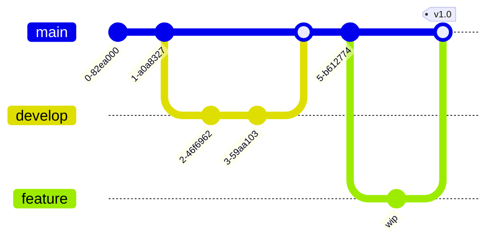

## C4 context

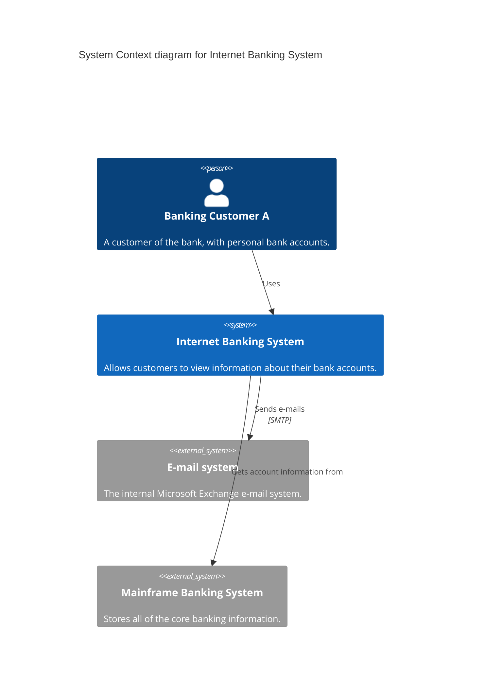

## Sankey

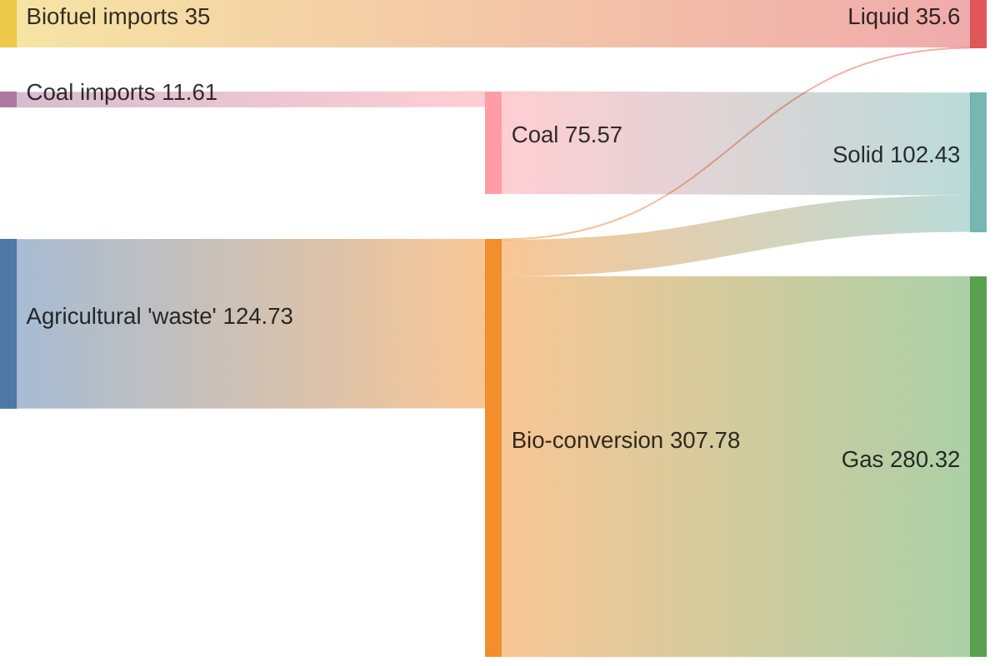

## XY chart

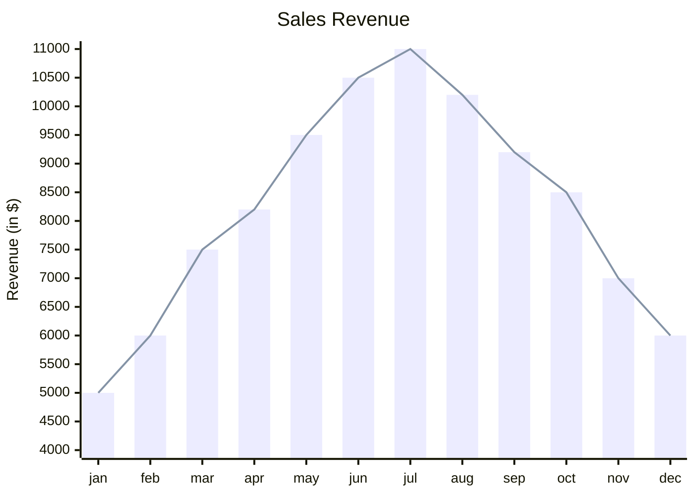

## Quadrant chart

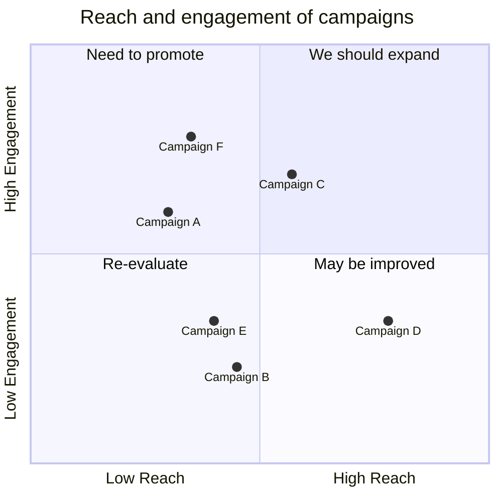

## Requirement

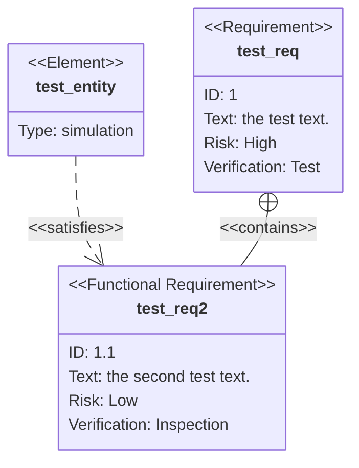

## Block

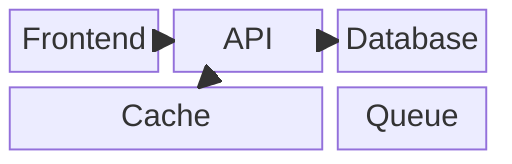

## Packet

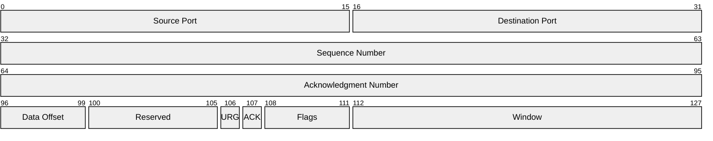

## Kanban

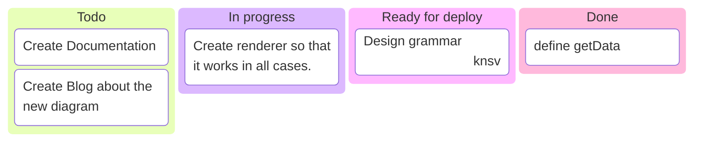

## Radar

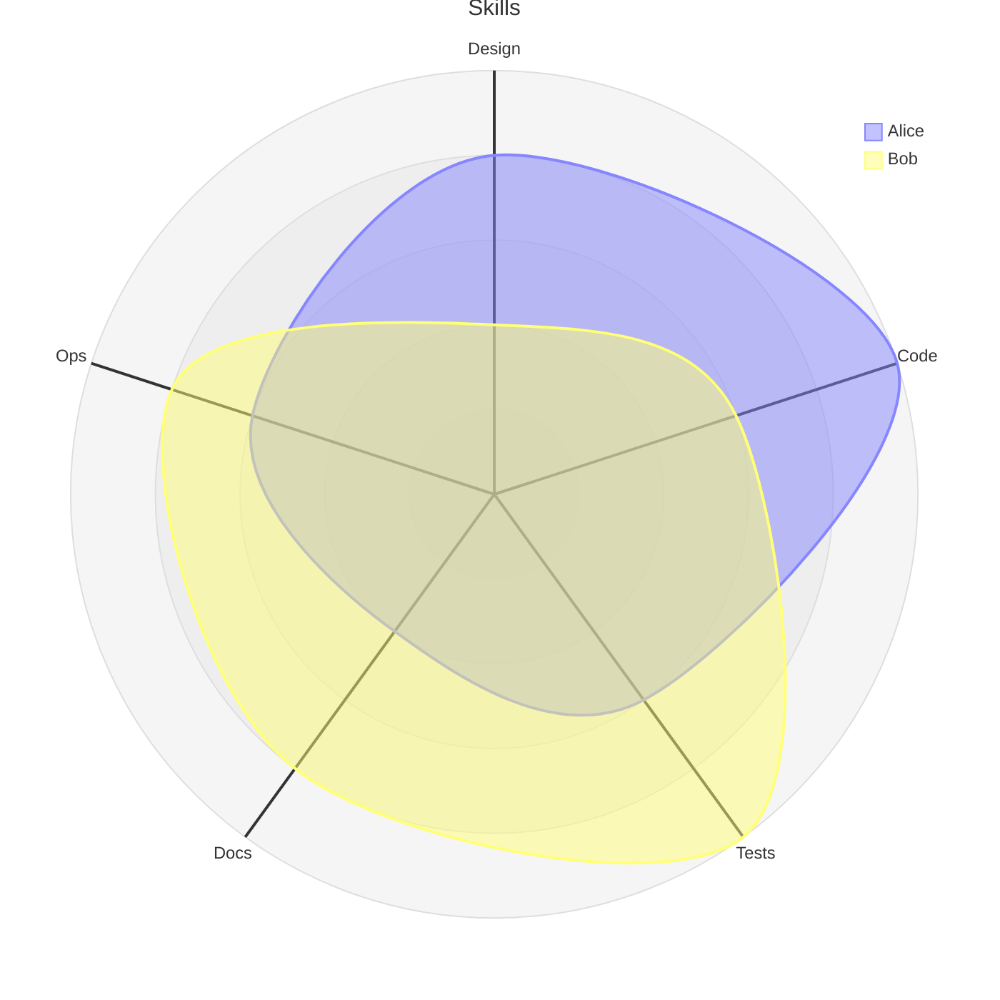

## Treemap

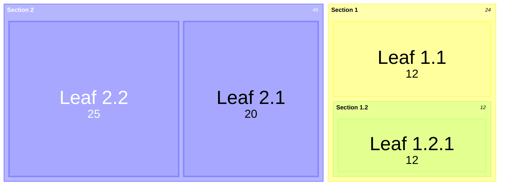

## Ishikawa (fishbone)

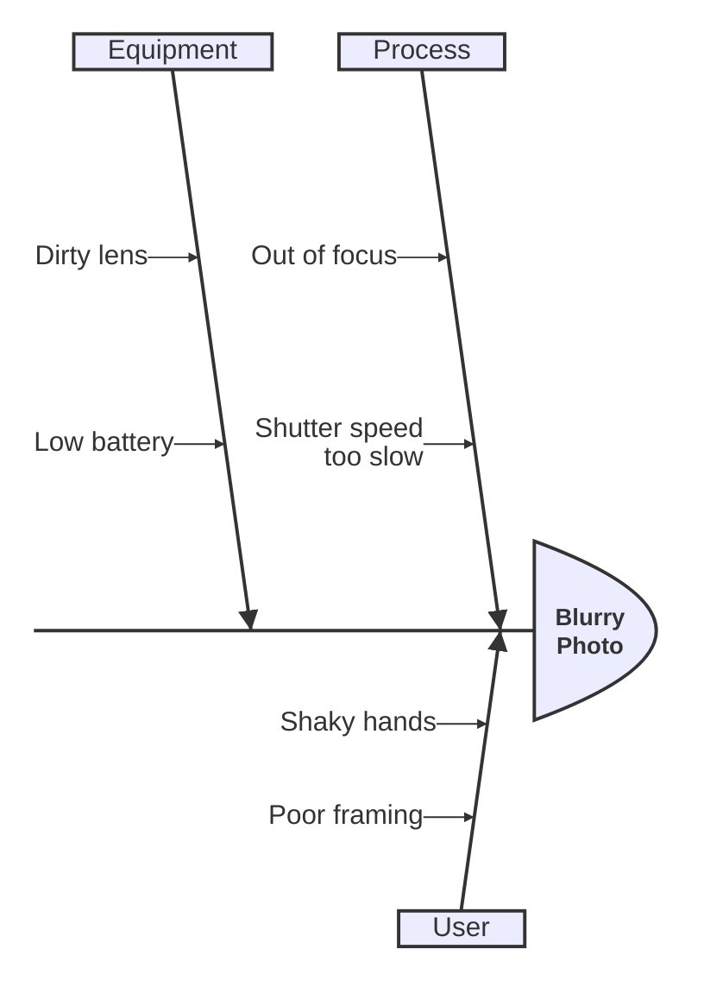

## Tree view

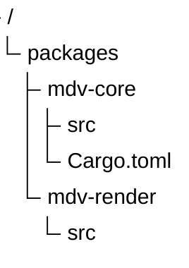

## Venn

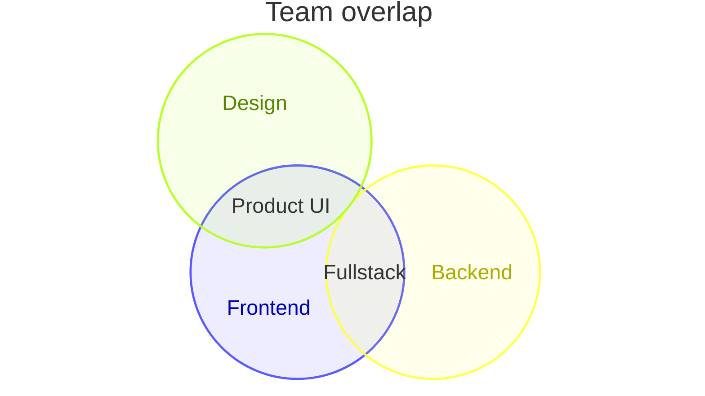

## Use case

```mermaid
usecase-beta
actor Customer
actor Clerk
Customer --> Browse
Customer --> Checkout
Clerk --> Checkout
Clerk --> Refund
```

## ZenUML

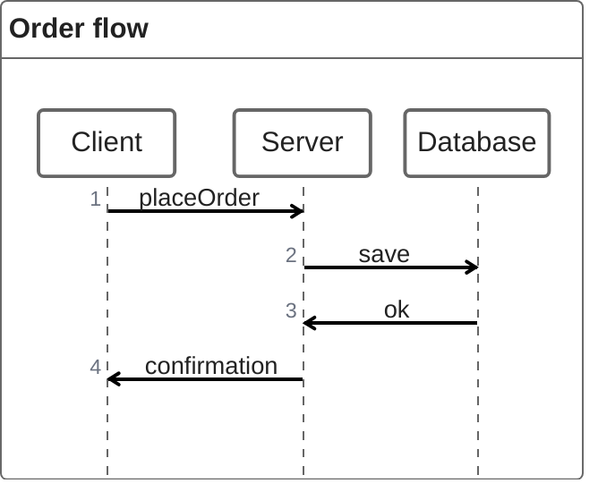

## Cynefin

```mermaid
cynefin-beta
  title Incident
  complex
    "Experiment"
  complicated
    "Analyse"
  clear
    "Best practice"
  chaotic
    "Act first"
```

## Event modeling

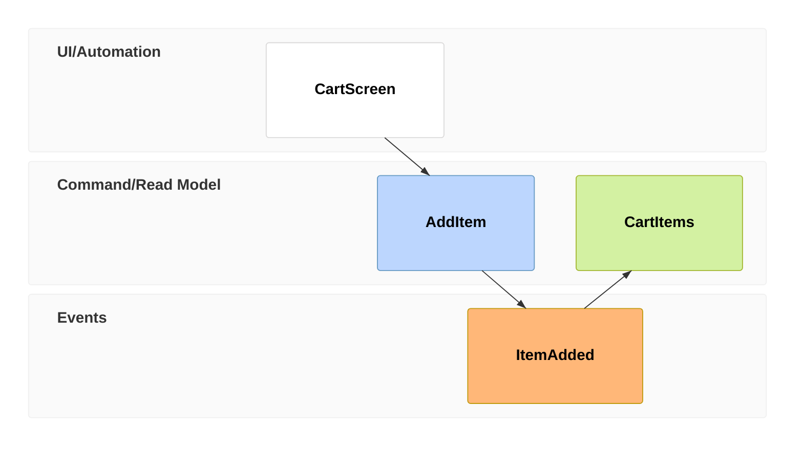

## Agent flow

```mermaid
agentflow-beta
Planner[Planner] --> Tool[Run tool]
Tool --> Check{Done?}
Check --> Planner
Check --> Answer[Answer]
```

## Swimlane

```mermaid
swimlane-beta
subgraph Customer
  A[Order] --> B[Pay]
end
subgraph Shop
  C[Pack] --> D[Ship]
end
B --> C
```

## Railroad (EBNF)

```mermaid
railroad-ebnf-beta
number = num , { num } ;
sum = number , { ( "+" | "-" ) , number } ;
group = "(" , sum , ")" ;
```

## Not enabled: architecture

Architecture diagrams need merman's Cytoscape layout, which is left out, so this block keeps its labelled source.

```mermaid
architecture-beta
    group api(cloud)[API]

    service db(database)[Database] in api
    service disk1(disk)[Storage] in api
    service server(server)[Server] in api

    db:L -- R:server
    disk1:T -- B:server
```
