# Everything mdview draws

One file with every feature the viewer supports, in the order of `docs/COVERAGE.md`. Open it,
scroll it, search it, resize the window, switch the theme: nothing here needs a network connection
except the last section.

**Contents:** [Text](#text) · [Headings](#headings) · [Lists](#lists) · [Quotes and alerts](#quotes-and-alerts) ·
[Code](#code) · [Tables](#tables) · [Links](#links-and-footnotes) · [Images](#images) ·
[HTML](#html) · [Math](#math) · [Diagrams](#diagrams) · [Remote images](#remote-images)

---

## Text

Plain text with **bold**, *italic*, ***bold italic***, ~~strikethrough~~ and ~one tilde~, `inline code`,
<ins>inserted</ins> and <u>underlined</u> text, H<sub>2</sub>O and E = mc<sup>2</sup>.

A soft line break
stays on the same line. A hard break, made with two trailing spaces  
or with a backslash\
starts a new one.

Escapes show the character itself: \*not italic\*, \# not a heading, \[not a link\]. Entities
are decoded: &copy; &amp; &lt;tag&gt; &rarr; &hearts; &#x1F600; &#960;.

Emoji shortcodes: :rocket: :tada: :+1: :heart: :warning: :octocat: stays as text when it has no glyph.

Keyboard keys <kbd>Ctrl</kbd> + <kbd>Shift</kbd> + <kbd>F</kbd>, <mark>highlighted text</mark>,
<small>small print</small>, <q>an inline quotation</q>, <var>x</var> as a variable,
<samp>sample output</samp>, <tt>teletype</tt>, <cite>A Cited Work</cite>, <dfn>a definition</dfn>
and <abbr title="Hypertext Markup Language">HTML</abbr>.

Ruby annotations: <ruby>漢<rp>(</rp><rt>kan</rt><rp>)</rp>字<rp>(</rp><rt>ji</rt><rp>)</rp></ruby> and
<ruby>東京<rt>とうきょう</rt></ruby>.

Other scripts: Türkçe ığüşöç İĞÜŞÖÇ, Ελληνικά, Кириллица, 日本語, 中文, 한국어, العربية, עברית.

<!-- This comment is hidden. -->

## Headings

# Heading 1
## Heading 2
### Heading 3
#### Heading 4
##### Heading 5
###### Heading 6

Setext heading 1
================

Setext heading 2
----------------

## Lists

- Unordered item
- Another, with a nested list:
  - Second level
    - Third level
      - Fourth level
- Back at the first level

An ordered list, with nested steps:

1. Ordered item
2. Second, with nested steps:
   1. Step one
   2. Step two
3. Third

A list can start at any number:

7. A list that starts at seven
8. Then eight

Task lists:

- [x] A finished task
- [ ] An open task
  - [x] A nested finished task
- [ ] Another open task

An item can hold paragraphs and code:

- A list item with two paragraphs.

  The second paragraph belongs to the same item.

  ```rust
  // And so does this code block.
  let nested = true;
  ```

HTML lists with lettered and roman markers, and a description list:

<ol type="a">
  <li>Lettered item</li>
  <li>Another lettered item</li>
</ol>

<ol type="i">
  <li>Roman item</li>
  <li>Another roman item</li>
</ol>

<dl>
  <dt>Description list term</dt>
  <dd>Its definition, indented under the term.</dd>
  <dt>Another term</dt>
  <dd>A definition with <strong>bold</strong> text and a <a href="#text">link</a>.</dd>
</dl>

## Quotes and alerts

> A blockquote.
>
> > A nested blockquote, with **formatting** and `code`.
>
> - A list inside a quote
> - Second item

> [!NOTE]
> Useful information that users should know, even when skimming.

> [!TIP]
> Helpful advice for doing things better or more easily.

> [!IMPORTANT]
> Key information users need to know to achieve their goal.

> [!WARNING]
> Urgent information that needs immediate attention to avoid problems.

> [!CAUTION]
> Advises about risks or negative outcomes of certain actions.

## Code

Indented code:

    fn indented() {
        println!("four spaces make a code block");
    }

```rust
/// Fenced code with syntax highlighting.
#[derive(Debug, Clone)]
struct Document<'a> {
    title: &'a str,
    blocks: Vec<u32>,
}

fn main() {
    let doc = Document { title: "README", blocks: vec![1, 2, 3] };
    println!("{doc:?} has {} blocks", doc.blocks.len());
}
```

```python
from dataclasses import dataclass

@dataclass
class Point:
    x: float
    y: float

    def norm(self) -> float:
        return (self.x ** 2 + self.y ** 2) ** 0.5

print(f"{Point(3, 4).norm():.1f}")  # 5.0
```

```typescript
type Theme = "light" | "dark" | "system";

export async function load(url: string): Promise<string> {
  const response = await fetch(url);
  if (!response.ok) throw new Error(`HTTP ${response.status}`);
  return response.text();
}
```

```json
{ "name": "mdview", "private": true, "features": ["tables", "math", "mermaid"], "zoom": 1.25 }
```

```bash
cargo build --release -p mdview && target/release/mdview.exe README.md
```

```diff
- let height = measure_everything();
+ let height = estimate_then_refine();
```

```c
#include <stdio.h>
int main(void) { printf("%d\n", 42); return 0; }
```

```html
<details open><summary>Title</summary><p>Body</p></details>
```

```sql
SELECT name, COUNT(*) AS tabs FROM sessions WHERE active = 1 GROUP BY name ORDER BY tabs DESC;
```

```yaml
theme: dark
panes: { files: true, outline: false }
```

```toml
[package]
name = "mdview"
edition = "2024"
```

```
A fence with no language is plain monospaced text, and a very long line scrolls or wraps without breaking the page layout: 0123456789 0123456789 0123456789 0123456789 0123456789 0123456789.
```

## Tables

| Left | Centre | Right |
|:-----|:------:|------:|
| `code` | **bold** | 1.00 |
| [link](#tables) | *italic* | 22.50 |
| ~~struck~~ | :tada: | 333.25 |

| Feature | Notes |
|---|---|
| Wide cells | A cell with enough text that it has to wrap onto more than one line at the reading width of the page, to show how rows grow. |
| Escaped pipe | `a \| b` stays inside one cell |

<table>
  <tr><th colspan="2">HTML table with spans</th><th>Third</th></tr>
  <tr><td rowspan="2">Two rows tall</td><td>B1</td><td align="right">right</td></tr>
  <tr><td>B2</td><td align="center">centre</td></tr>
</table>

<table width="70%" align="center">
  <caption>A caption, over a table that is 70% wide and centred</caption>
  <tr><th width="60%">A column 60% wide</th><th>Lines</th></tr>
  <tr><td valign="bottom">Bottom of its cell</td><td>one<br>two<br>three</td></tr>
  <tr align="right" height="60"><td valign="middle">Right, middle, in a row 60 px tall</td><td>end</td></tr>
</table>

## Links and footnotes

- An inline link: [the Tables section](#tables)
- A reference link: [CommonMark][cm], defined at the end of the section
- A relative link to another file: [linked.md](linked.md)
- A bare URL: https://example.com/path?query=1 and an email: hello@example.com
- An angle-bracket autolink: <https://example.org>
- A link with a title: [hover me](https://example.com "A title shown as a tooltip")

Footnotes are numbered by first reference[^first], can be named[^named], and can be used
twice[^first].

[cm]: https://commonmark.org "CommonMark"

[^first]: The first footnote, which the page lists at the end.
[^named]: A named footnote with **formatting** and more than one sentence. It still gets a number.

---

Horizontal rules, three ways:

***

___

## Images

A PNG, inline with text  and an SVG .

A GIF (first frame) , a lossy WebP 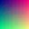 and a WebP
with transparency .

A sized HTML image: 

<p align="center">
  
</p>

 An image with `align="right"` stands at the right of its paragraph and the text keeps to the column beside it, for as many lines as the paragraph has. With `align="left"` it stands at the left.

Against the line: middle , top  and the default, on the baseline .

A picture that follows the theme:

<picture>
  <source media="(prefers-color-scheme: dark)" srcset="assets/badge.svg">
  <source media="(prefers-color-scheme: light)" srcset="assets/badge.png">
  
</picture>

<figure>
  
  <figcaption>A figure with a caption in muted, smaller text.</figcaption>
</figure>

A missing image keeps its alt text: 

## HTML

<details>
<summary>A collapsed section (click to open)</summary>

Hidden content with **Markdown** inside, a list and code:

- one
- two

```rust
let open = true;
```

</details>

<details open>
<summary>A section that starts open</summary>

It can be closed again. Only this block is laid out again when it toggles.

</details>

<div align="center">

**Centred block** with a paragraph of Markdown inside a `<div align="center">`.

</div>

<p align="right">Right-aligned paragraph.</p>

<p align="justify">A justified paragraph needs enough words to fill more than one line, so that the spacing between the words can stretch and both edges of the text line up with the edges of the column, which is what this sentence is here to show.</p>

<p dir="rtl">فقرة من اليمين إلى اليسار.</p>

<p dir="rtl">A paragraph marked right-to-left starts at the right, whatever script it is in.</p>

<center>The old <code>&lt;center&gt;</code> tag still centres.</center>

<hr width="50%">

Scripts and styles never run; they are shown as text: <script>alert("no")</script>

## Math

Inline math sits on the baseline: $E = mc^2$, $\frac{a}{b}$, $\sqrt{x^2 + y^2}$ and
$\sum_{i=1}^{n} i = \frac{n(n+1)}{2}$. GitHub's other inline form works too: $`\alpha + \beta`$.

$$
\int_0^1 x^2 \, dx = \frac{1}{3}
\qquad
\begin{pmatrix} a & b \\ c & d \end{pmatrix}
$$

```math
\nabla \cdot \vec{E} = \frac{\rho}{\varepsilon_0}
\qquad
e^{i\pi} + 1 = 0
```

Right-click a formula or a diagram to copy its source.

## Diagrams

### Flowchart

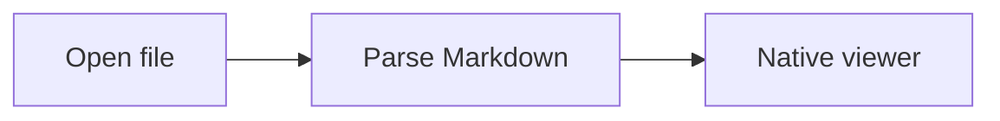

### Class

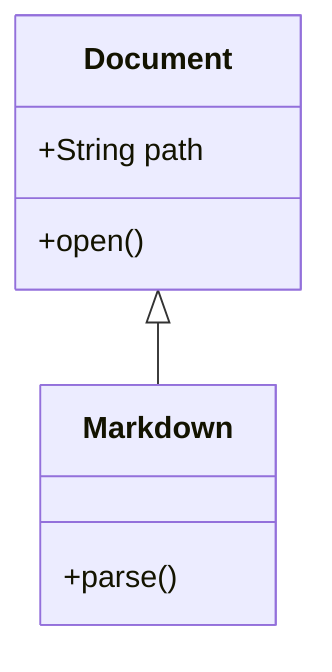

### Entity relationship

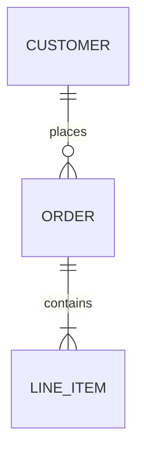

### Mindmap

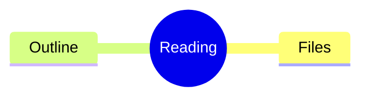

### State

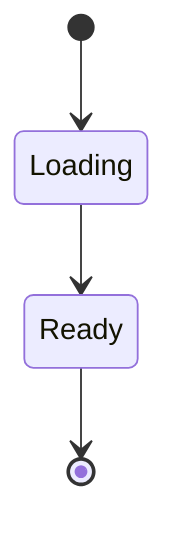

### Timeline

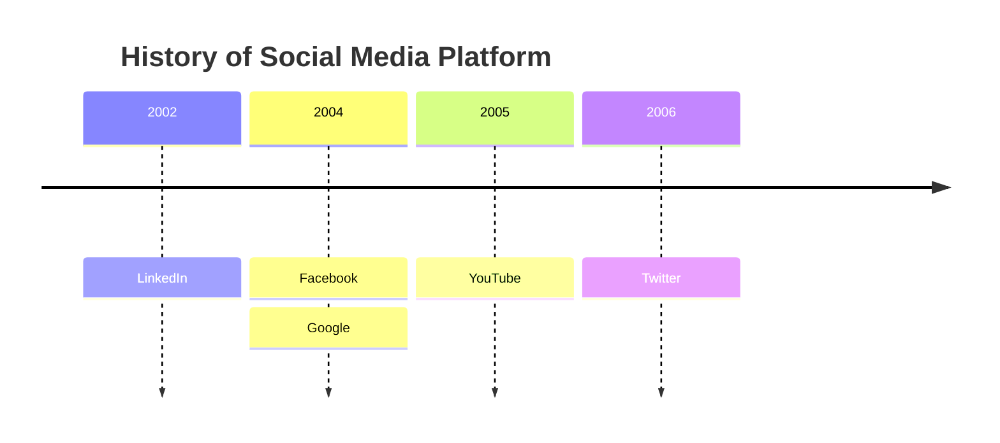

### User journey

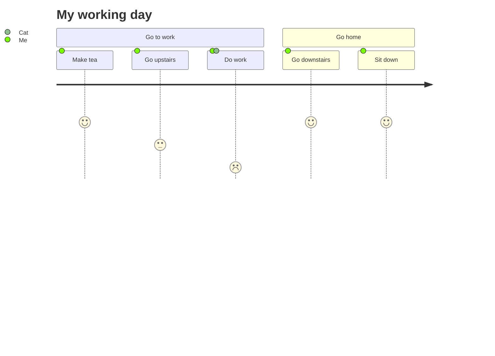

### Git graph

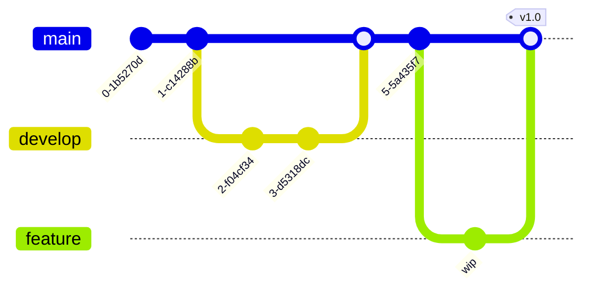

### C4 context

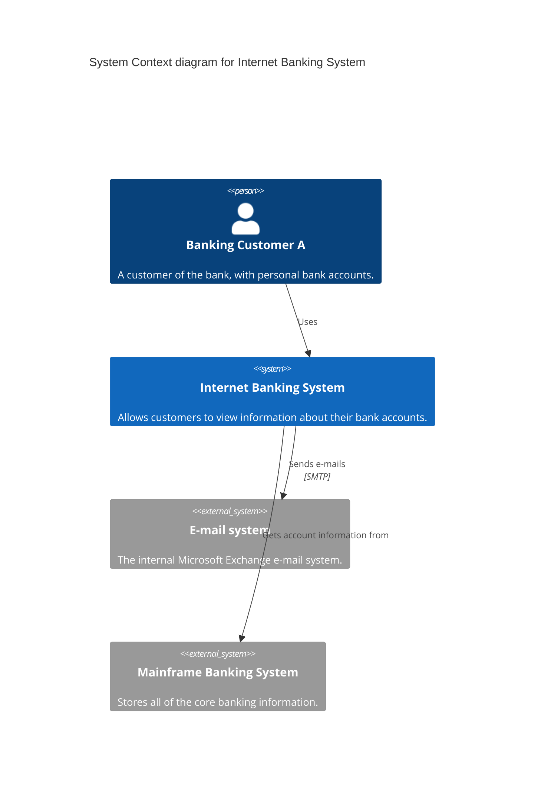

### Sankey

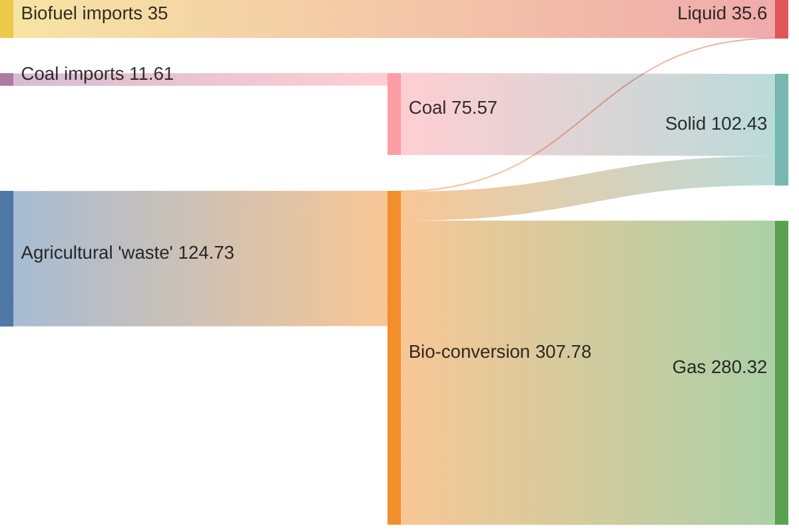

### XY chart

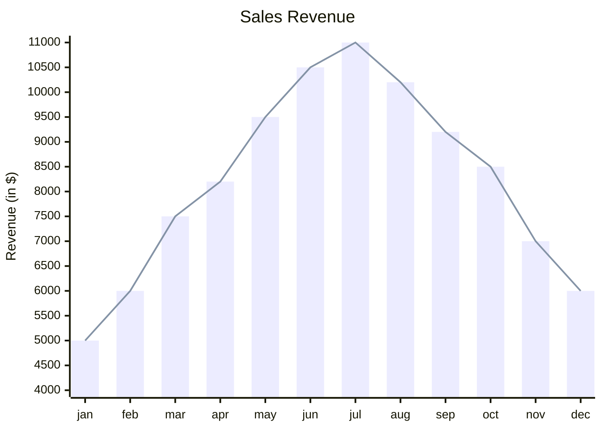

### Quadrant chart

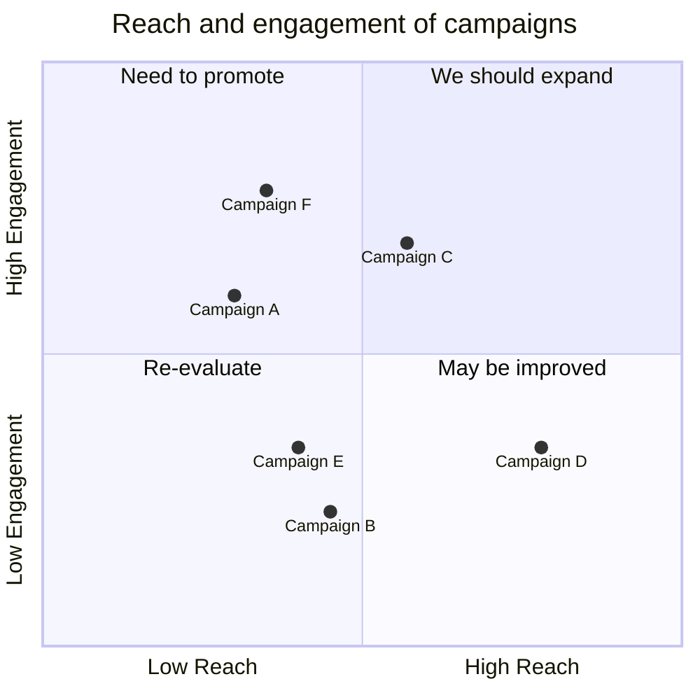

### Requirement

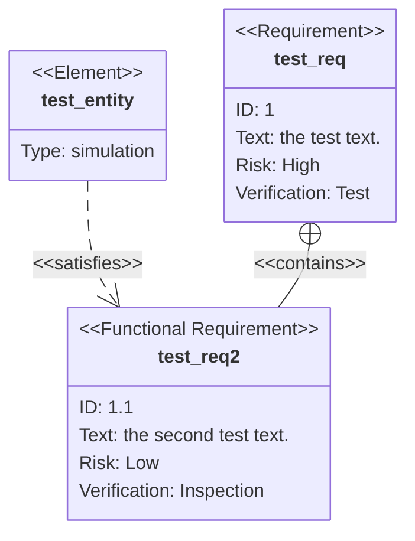

### Block

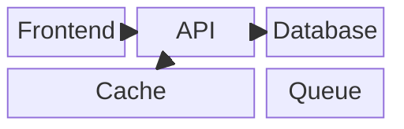

### Packet

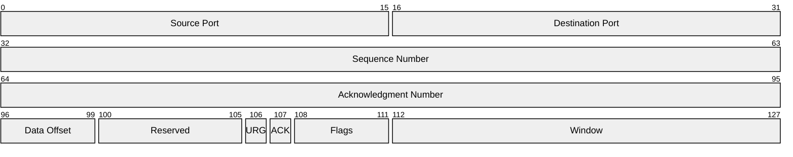

### Kanban

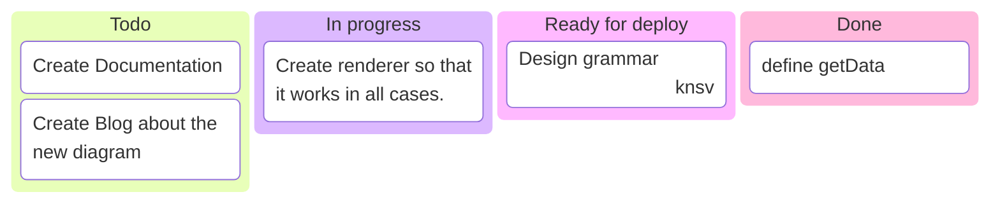

### Radar

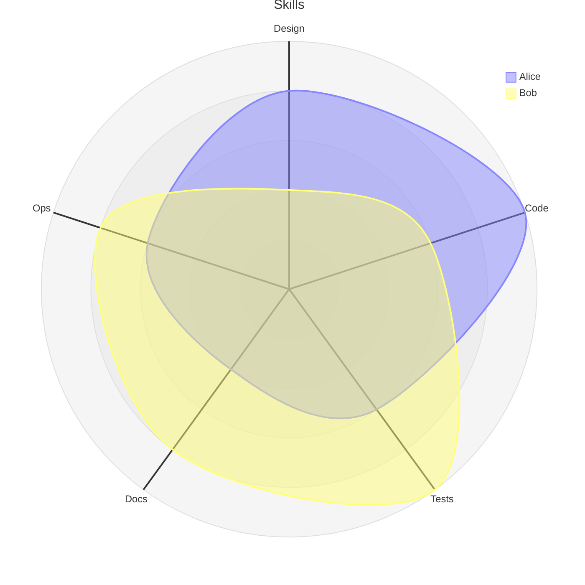

### Treemap

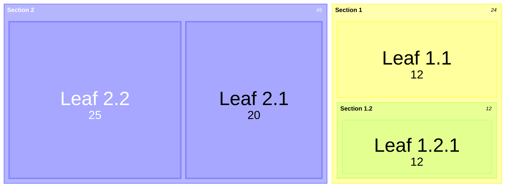

### Ishikawa (fishbone)

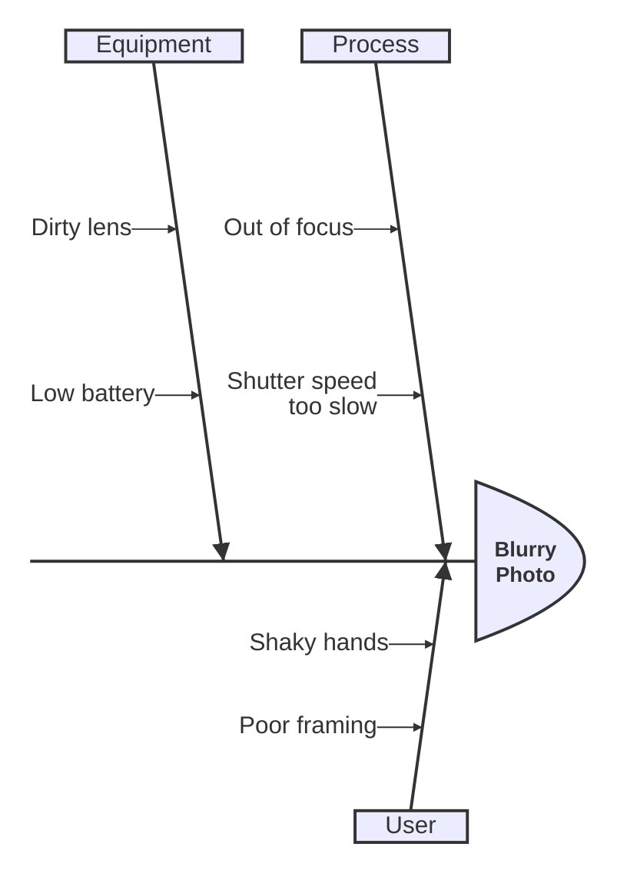

### Tree view

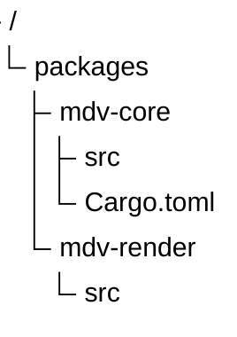

### Venn

```mermaid
venn-beta
  title Team overlap
  set A["Frontend"]
  set B["Backend"]
  set C["Design"]
  union A,B["Fullstack"]
  union A,C["Product UI"]
```

### Use case

```mermaid
usecase-beta
actor Customer
actor Clerk
Customer --> Browse
Customer --> Checkout
Clerk --> Checkout
Clerk --> Refund
```

### ZenUML

```mermaid
zenuml
    title Order flow
    Client->Server: placeOrder
    Server->Database: save
    Database->Server: ok
    Server->Client: confirmation
```

### Cynefin

```mermaid
cynefin-beta
  title Incident
  complex
    "Experiment"
  complicated
    "Analyse"
  clear
    "Best practice"
  chaotic
    "Act first"
```

### Event modeling

```mermaid
eventmodeling
tf 01 ui CartScreen
tf 02 cmd AddItem
tf 03 evt ItemAdded
tf 04 rmo CartItems
```

### Agent flow

```mermaid
agentflow-beta
Planner[Planner] --> Tool[Run tool]
Tool --> Check{Done?}
Check --> Planner
Check --> Answer[Answer]
```

### Swimlane

```mermaid
swimlane-beta
subgraph Customer
  A[Order] --> B[Pay]
end
subgraph Shop
  C[Pack] --> D[Ship]
end
B --> C
```

### Railroad (EBNF)

```mermaid
railroad-ebnf-beta
number = num , { num } ;
sum = number , { ( "+" | "-" ) , number } ;
group = "(" , sum , ")" ;
```

### A family that is not enabled keeps its source

Architecture diagrams need merman's Cytoscape layout, which is left out, so this block keeps its labelled source.

```mermaid
architecture-beta
    group api(cloud)[API]

    service db(database)[Database] in api
    service disk1(disk)[Storage] in api
    service server(server)[Server] in api

    db:L -- R:server
    disk1:T -- B:server
```

## Remote images

Remote images stay off until you choose **Load images** in the bar above the page.

 


