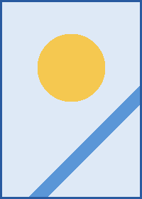

# Floated images



An image with `align="right"` stands at the right of the column, and everything after it runs beside it until its bottom is passed. This first paragraph is beside it, and so is the next one.

A second paragraph, still beside the image, with a [link](https://example.com), some `code` and enough words to wrap onto a second and a third line in the narrower column that the image leaves.

## A heading beside the float

- A list item beside the image.
- A second item, long enough to wrap in the narrow column so that its second line shows where the text ends.
- A third item.

By now the text has passed the bottom of the image, so this paragraph runs the full width of the column again, as every block after it does until another image floats.


With `align="left"` the image stands at the left and the text starts after it. Lists, quotes and code blocks move over as a whole:

1. A numbered item beside the left image.
2. And another, with its marker next to the text.

> A quote is a box too: it stands beside the image.

```rust
fn beside() -> &'static str {
    "a code block keeps its shape: narrower, also below the image's bottom"
}
```

A table does not narrow. It starts below the image:

| Block | Beside a float |
|---|---|
| Paragraph, heading, list | lines wrap |
| Code, quote, details, rule | narrower box |
| Table, diagram, display math | starts below |

## Two at once


One paragraph can float several images. These two stand at either side and the text runs between them for as long as both last, in a column that is narrower on both sides, and then under them at the full width of the column once it has passed their bottoms, which takes a few more words than this.

 A float that starts while another on its side is still open goes below it: the badge of this paragraph stands under the panel at the right.

---

A rule ends the section. Inside a list item a float stays in its item:

-  An item with its own floated image. The item grows to hold the image, so the next item starts below it.
- The next item, at full width.

## At the end

 The last paragraph of the document floats an image that is taller than its text. The page ends below the image, not below the text.
