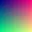

# Image formats

Each supported raster format, drawn from a real file.

A GIF with a transparent offset frame (a single frame, so it stays still):

An animated GIF, red first; in a window it plays, in a `--shot` render it stays on its first frame:

A lossy WebP, a gradient:

A lossless WebP with alpha, inline in a sentence  so the edges show against the page.

An animated WebP, yellow first:

The PNG for comparison:

