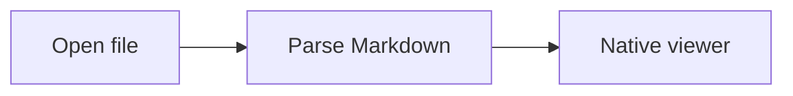
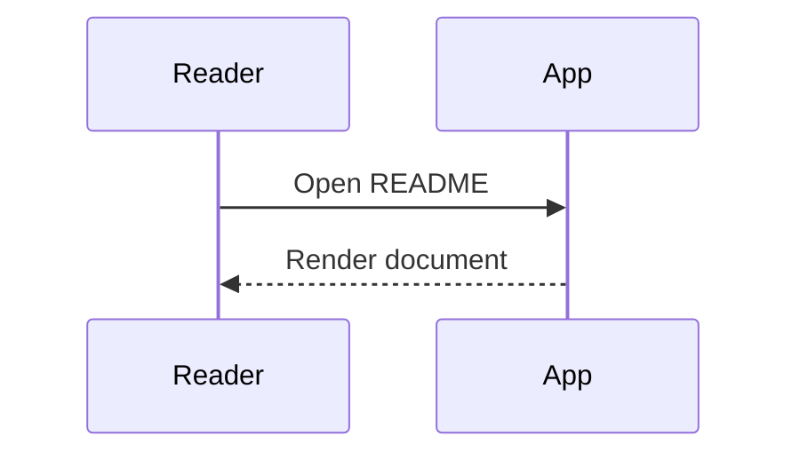
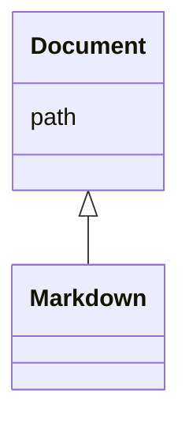
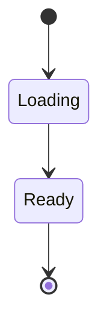
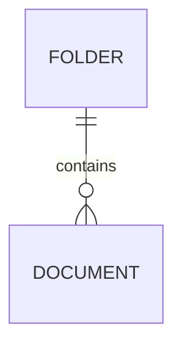
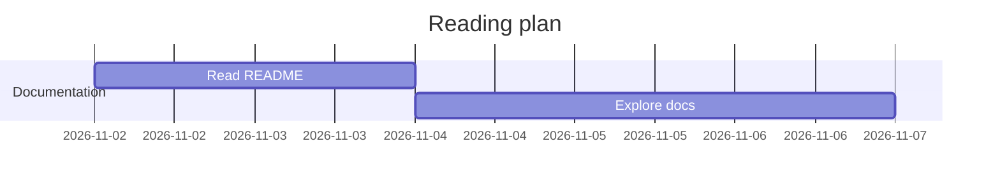
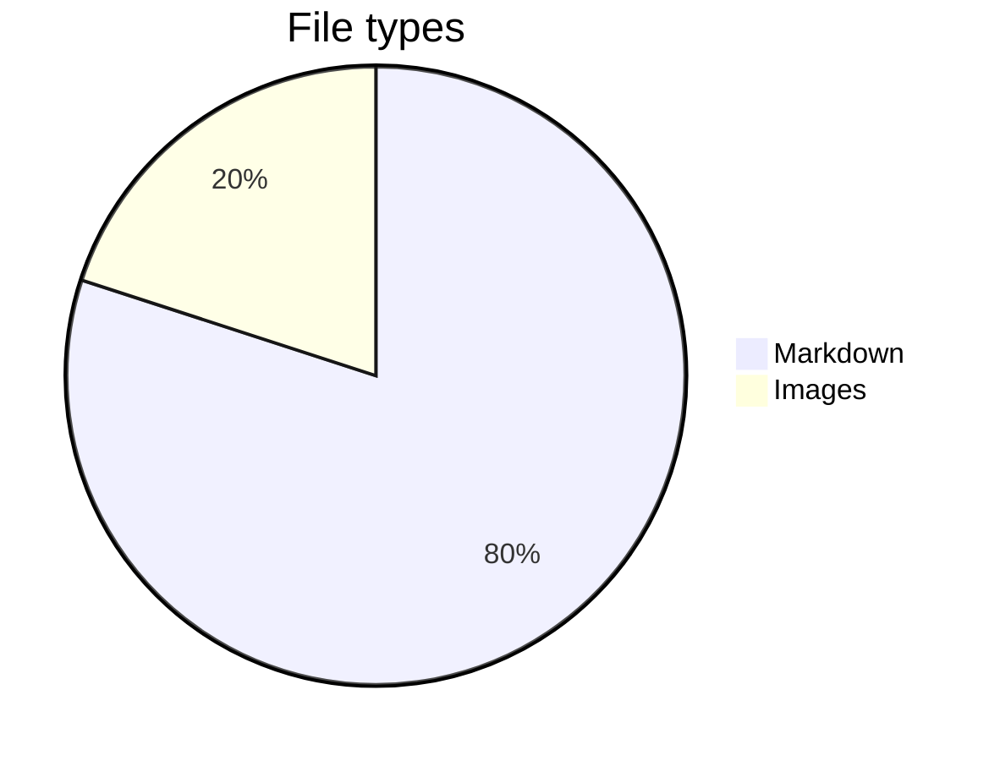
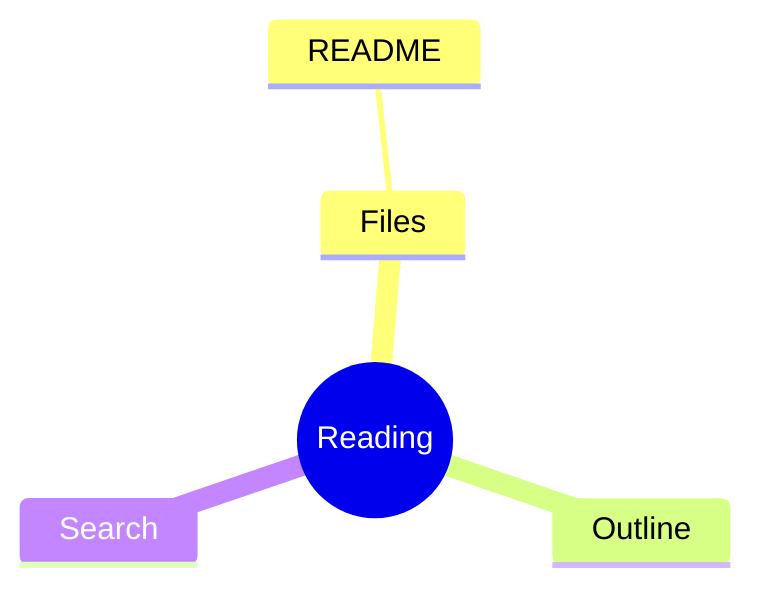

# Native Markdown Reader

A comfortable desktop home for your README files. **Bold**, *italic*, ~~struck through~~, and `inline code`.

[Jump to diagrams](#diagrams) · [Open another document](linked.md#second-page)

## GitHub Markdown

| Feature | Status | Notes |
| :--- | :---: | ---: |
| Tables | Ready | Left / center / right |
| Tasks | Ready | Read only |
| Unicode | Ready | Türkçe — 日本語 |

- [x] Open local Markdown
- [x] Read without a browser
- [ ] Try your own README

> [!NOTE]
> Documents refresh when saved by another editor, and keep your place.

```rust
fn main() {
    let message = "Hello, Markdown!";
    println!("{}", message);
}
```

## HTML and images

<p align="center"><b>A small HTML heading</b><br><a href="https://github.com"></a></p>

<details>
<summary>Read more about this viewer</summary>

**This section is collapsible.** It contains Markdown and a [local link](linked.md).

</details>

An unavailable image should not block reading: 

## Floats, animation and notes


A picture with `align="right"` stands at the side, and what follows runs beside it until its bottom is passed: this paragraph and the list under it.

- An animated GIF plays in the window: 
- A file opens where you left it, and a reload keeps your place.
- `[[linked]]` is a wiki-link to a note beside this file: [[linked]], or with other words, [[linked|the second page]].

```kotlin
data class Note(val name: String, val links: List<String> = emptyList()) // Kotlin
```

```powershell
Get-ChildItem -Filter *.md | Where-Object { $_.Length -gt 1KB }  # PowerShell
```

A table is as wide as its content, like the one at the top; Swift and Dockerfile blocks are coloured too:

```dockerfile
FROM rust:1.80 AS build
COPY . /src
RUN cargo build --release
```

## Mathematics

Inline math: $e^{i\pi}+1=0$ and $\frac{a}{b}$.

$$
\int_0^1 x^2 dx = \frac{1}{3}
$$

```math
\sum_{i=1}^{n} i = \frac{n(n+1)}{2}
```

## Diagrams

### Flowchart



### Sequence



### Class



### State



### Entity relationship



### Gantt



### Pie



### Mindmap



## Repeated heading

First occurrence.

## Repeated heading

Second occurrence, with a unique anchor.

A footnote reference[^one].

[^one]: Footnotes stay in the document.
