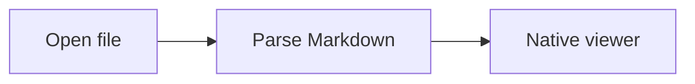
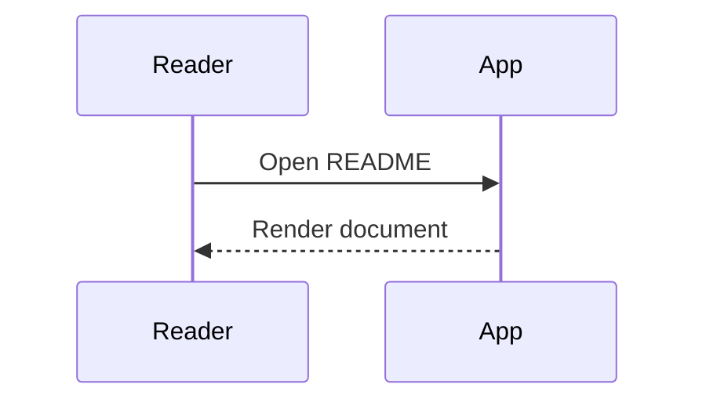
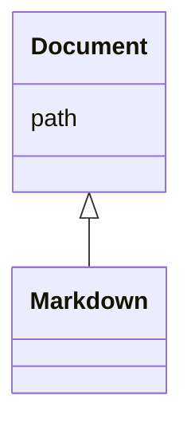
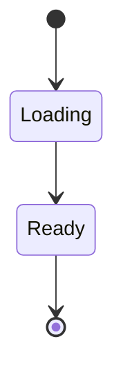
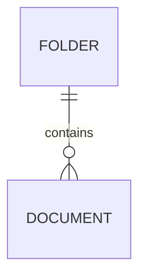
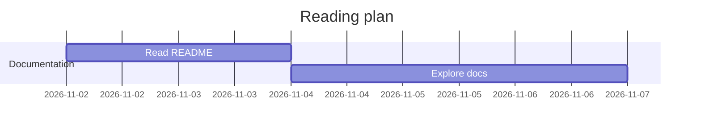
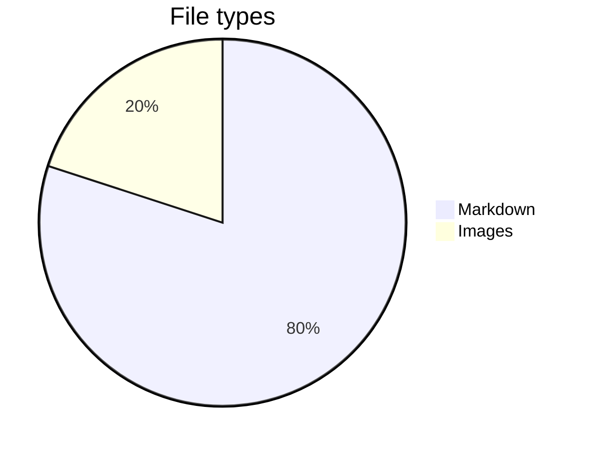
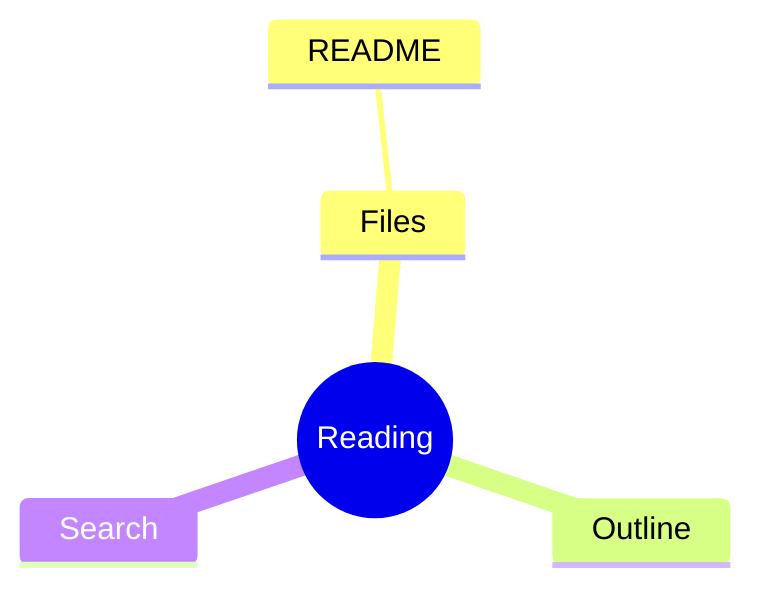

# Native Markdown Reader

A comfortable desktop home for your README files. **Bold**, *italic*, ~~struck through~~, and `inline code`.

[Jump to diagrams](#diagrams) · [Open another document](linked.md#second-page)

## GitHub Markdown

| Feature | Status | Notes |
| :--- | :---: | ---: |
| Tables | Ready | Left / center / right |
| Tasks | Ready | Read only |
| Unicode | Ready | Türkçe — 日本語 |

- [x] Open local Markdown
- [x] Read without a browser
- [ ] Try your own README

> [!NOTE]
> Documents refresh when saved by another editor.

```rust
fn main() {
    let message = "Hello, Markdown!";
    println!("{}", message);
}
```

## HTML and images

<p align="center"><b>A small HTML heading</b><br><a href="https://github.com"></a></p>

<details>
<summary>Read more about this viewer</summary>

**This section is collapsible.** It contains Markdown and a [local link](linked.md).

</details>

An unavailable image should not block reading: 

## Mathematics

Inline math: $e^{i\pi}+1=0$ and $\frac{a}{b}$.

$$
\int_0^1 x^2 dx = \frac{1}{3}
$$

```math
\sum_{i=1}^{n} i = \frac{n(n+1)}{2}
```

## Diagrams

### Flowchart



### Sequence



### Class



### State



### Entity relationship



### Gantt



### Pie



### Mindmap



## Repeated heading

First occurrence.

## Repeated heading

Second occurrence, with a unique anchor.

A footnote reference[^one].

[^one]: Footnotes stay in the document.
