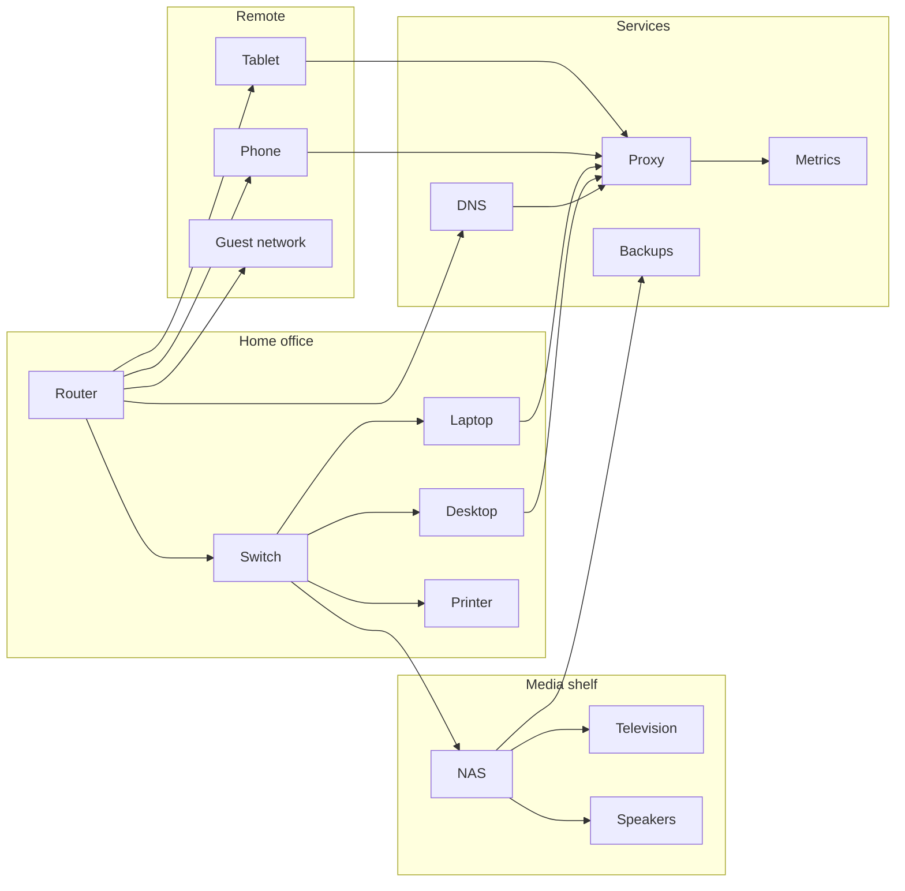

Wide diagram

A `flowchart LR` with nested subgraphs, about twenty nodes, for the diagram zoom view. It is
wider than the page's column, so the page draws it shrunk and a click opens it at a reading size.

After the diagram, a paragraph, so the page has text above and below it.
