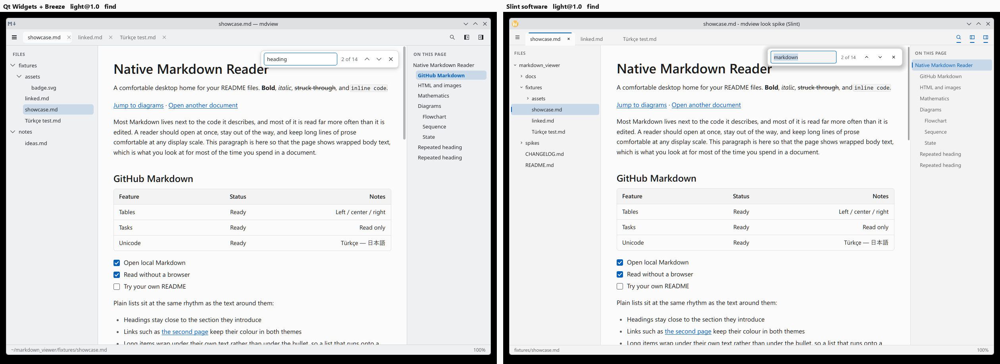
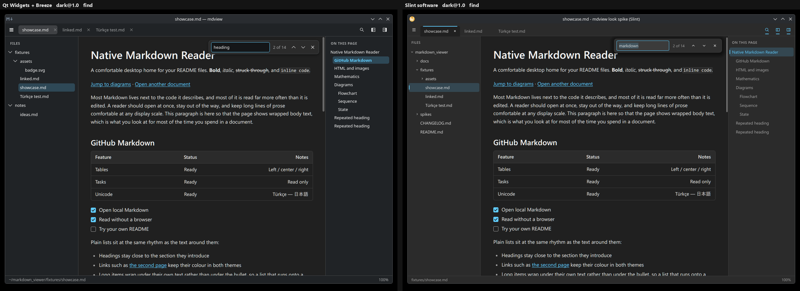
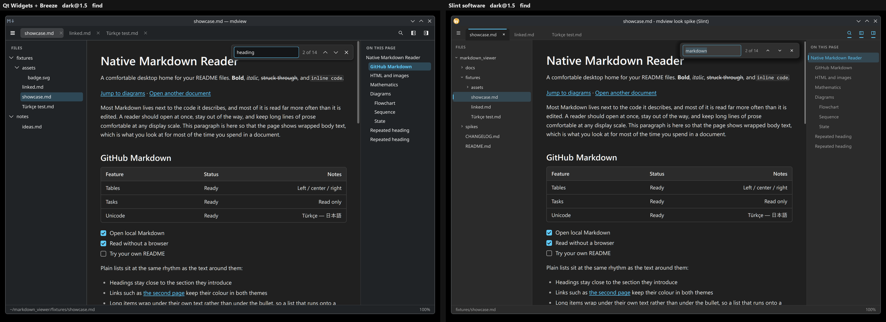

# Qt vs Slint: side-by-side look and numbers

No winner is picked on looks; that decision is yours. Everything here ran on Linux in a virtual KWin. **Neither toolkit has run on Windows 11, the real target.** Method and raw numbers are in `RESULT.md`.

## Open the live windows

Both are the rebuilt binaries, same profile. Each stays open until you close it, and uses your desktop's scale.

```sh
cd /home/kaan/markdown_viewer/spikes/look-compare

# Qt
target/qt/release/look-qt --theme=light --find-open
target/qt/release/look-qt --theme=dark --find-open

# Slint (--no-kde gives it the same blue accent as Qt's --theme)
target/slint/release/look-slint --no-kde --theme=light --find
target/slint/release/look-slint --no-kde --theme=dark --find
```

Leave out the flags to follow your desktop theme. Slint then takes your olive KDE accent. Qt's hover tints come from your real `kdeglobals` even with `--theme`.

The same arguments ran in the virtual KWin sessions. The commands themselves were not run on your desktop.

## Pairs

Qt is on the left, Slint on the right, at 1:1 device pixels with no resampling. All have the find bar open.

| | Light | Dark |
|---|---|---|
| Scale 1.0 | [light@1.0](pairs/light@1.0-find.png) | [dark@1.0](pairs/dark@1.0-find.png) |
| Scale 1.5 | [light@1.5](pairs/light@1.5-find.png) | [dark@1.5](pairs/dark@1.5-find.png) |






Also in `pairs/`:
- `*-plain.png`: find bar closed.
- `*-menu.png` and `*-menu2.png`: app menu, then File flyout, opened with real compositor input.
- `zoom/`: Qt on top, Slint below. Scale 1.0 crops are enlarged 2x; scale 1.5 crops are 1:1.

Some differences come from the stand-in content, not the toolkit: the find text ("heading" and "markdown"), the tree contents, the window title, and the outline's current row.

## Comparison

Launch and memory are medians of 10 runs (12, first 2 dropped) from batch B, light theme, at 1220x820. The launch cells are measured and noisy: another batch at a different time was about 20-25 ms slower for both apps (see `RESULT.md`).

| | Qt Widgets + Breeze | Slint, software renderer |
|---|---|---|
| **Launch, 1.0 / 1.5 / 2.2** | 62.2 / 62.9 / 65.5 ms | 45.4 / 46.5 / 60.6 ms |
| **Private_Dirty** | 19.96 / 24.52 / 34.32 MiB | 5.33 / 7.45 / 11.97 MiB |
| **Pss** | 39.14 / 51.26 / 76.60 MiB | 19.01 / 25.90 / 40.43 MiB |
| **Unique to the process right now** (Private_Clean + Private_Dirty) | 24.71 / 32.09 / 47.64 MiB | 13.00 / 15.10 / 19.72 MiB |
| **Owned whoever else runs** (anon + window buffers + dirty file pages) | 27.82 / 41.79 / 71.19 MiB | 12.83 / 24.50 / 48.86 MiB |
| **Library pages touched (Rss), and how many are unique** | 55.3 MiB, 5.9 unique | 4.8 MiB, 0.26 unique |
| **Full-size window buffers before first present** | 3 or 4 | 2 |
| **Idle CPU, 30 s, 3 runs per scale** | 0.0001-0.0004% (0.02-0.13 ms), 1 wakeup | 0.0013-0.0031% (0.40-0.94 ms), 60 wakeups |
| **Idle with blinking caret, scale 1.0, 2 runs** | 0.16-0.41% | 0.06-0.18% |
| **Binary, same profile** | 1,481,000 bytes (1.41 MiB), plus system Qt | 13,857,888 bytes (13.22 MiB), self-contained except fontconfig/freetype |
| **Libraries loaded on this desktop** | 139 `.so`, 156.8 MiB on disk, including KIO and Qt Quick through the Plasma theme plugin | 21 `.so`, 9.0 MiB on disk |
| **Pixel exactness, 1.0 / 1.5 / 2.2** | PASS, 24 of 24, 0 differing pixels | PASS, 24 of 24, 0 differing pixels |
| **Native gaps seen here** | Scrollbar has no fade or widening. System icons can't load through the bridge (reads SVG paths). | Menus are not real popups: 0 `get_popup` calls, against 2 in Qt, so they can't leave the window. No app ID, so the title bar shows a generic icon. Shadows are faked. |
| **Native gaps reported, not re-tested** | Splitter, tab drag and close-by-click untested. | No Alt mnemonics. Tabs and icon buttons have no keyboard focus. Text field copy, paste and context menu untested or absent. IME not run. |
| **Licence** | LGPLv3 or GPLv3 or commercial (Qt). cxx-qt is MIT or Apache-2.0. Ship DLLs replaceably on Windows. | GPLv3, or Royalty-free 2.0 with an attribution (About widget or public web badge), or paid. |
| **Authored code** | 2,150 lines of Rust, with `unsafe` in `src/qt/` (109 lines contain the word). | 2,177 lines of Rust and `.slint`, with no `unsafe`. |
| **Carry-forward to Windows 11** | Breeze, its icon paths, `.colors` and `kdeglobals` do not exist there, so this look does not transfer. It would need Qt's `windows11` style and a new look test. Qt6 Core, Gui and Widgets total 24.8 MiB on Linux (measured), plus plugins (estimate), and no Plasma shares them. | The look and all components should transfer, since it draws everything itself (estimate). 237-crate Windows tree, never compiled. No DirectWrite or ClearType, and Mica not attempted. All widgets stay hand-built: tab overflow is missing. |
| **Carry-forward of the page** | Direct blit from Rust, no extra copy. | Needs viewport mode and an extra copy per frame, because full pages blank past 4095 device px (from `look-slint/RESULT.md`, not re-tested). |

**Read the memory rows together.** Slint's Private_Dirty looks about 4x lower at 1.0 mainly because all its window buffers count as shared with KWin, while Qt holds a third buffer that KWin hasn't mapped. On the "owned" row the gap is about 2x at 1.0 and about 1.5x at 2.2.

**Qt's sharing with Plasma:** only 5.9 of its 55.3 MiB of library pages are unique to it, because Plasma already holds the rest. Without Plasma there's nothing to share them with, so the unique figures above flatter Qt. Its Rss of 90.06 MiB at 1.0 is the upper bound here (Slint: 32.53 MiB).

## Visual defects

Seen in the four pairs, the two `menu2` pairs named in `RESULT.md`, and the zoom crops.

**Both**
- The find bar overlaps the end of the H1 and hides the top of the "d" at the default width.
- Chrome text had no colour fringes in the status bar (0 coloured pixels in both), while the document uses LCD text. The two sit side by side with different rendering. Only the status bar was checked, and only in the virtual session.

**Qt**
- Chrome is Noto Sans next to a Segoe UI document, so there are two typefaces. It follows the desktop font, which has no setting here.
- The sidebar toggles are solid black or white blocks, much heavier than the search icon beside them.
- The active tab's close X sits tight against the pill's right edge, and inactive tabs show theirs with a wide gap.
- Selected rows start at the text, not the row edge, so the pill's left edge shifts with depth.
- Breeze's cool sidebar (32,35,38 and 239,240,241) sits beside a neutral page (#202020 and #FBFBFB). This is most visible in dark.
- Tree chevrons are large relative to the text.
- "Close Tab Ctrl+W" has almost no gap between label and shortcut.
- The outline marks "GitHub Markdown" as current while the page is at the top (not wired).

**Slint**
- The title bar shows a generic Wayland "W" icon and the title reads "mdview look spike (Slint)".
- The find bar and menu shadows show a visible banded halo in light, from stacked rectangles.
- Inactive tabs show no close button, in the captured state.
- Tab labels sit about 4 px lower than the menu icon at 1.0.
- All three toolbar toggles are accent-coloured and underlined, so they read like three selected tabs.
- Find-bar arrows, close icon and tree chevrons are small and thin next to the field.
- Outline text is dimmer: strongest pixel 5.7:1 in light and 6.0:1 in dark. Qt's outline, whose sampled area includes its selected row, reaches 13.3:1 and 15.4:1. Both clear 4.5:1.
- In dark, KWin's cool title bar sits above neutral grey chrome. This comes from Breeze decoration and won't apply on Windows.
- At 2.2 the window is 2 device px larger than asked (2686x1806, against 2684x1804 for Qt).

## What you still have to decide or check

1. Which look you prefer, from the live windows.
2. Whether either holds up on Windows 11. This comparison can't tell you: fonts, title bar, text rendering and launch cost all change there.
