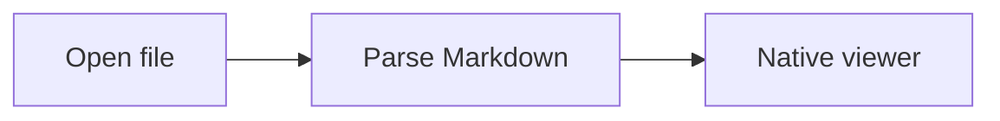
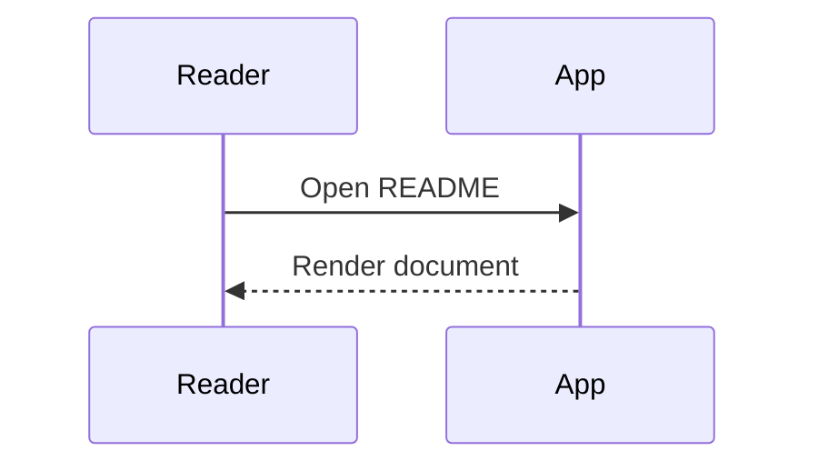
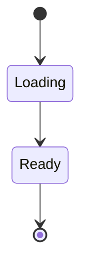

# Native Markdown Reader

A comfortable desktop home for your README files. **Bold**, *italic*, ~~struck through~~, and `inline code`.

[Jump to diagrams](#diagrams) · [Open another document](linked.md#second-page)

Most Markdown lives next to the code it describes, and most of it is read far more often than it is edited. A reader should open at once, stay out of the way, and keep long lines of prose comfortable at any display scale. This paragraph is here so that the page shows wrapped body text, which is what you look at for most of the time you spend in a document.

## GitHub Markdown

| Feature | Status | Notes |
| :--- | :---: | ---: |
| Tables | Ready | Left / center / right |
| Tasks | Ready | Read only |
| Unicode | Ready | Türkçe — 日本語 |

- [x] Open local Markdown
- [x] Read without a browser
- [ ] Try your own README

Plain lists sit at the same rhythm as the text around them:

- Headings stay close to the section they introduce
- Links such as [the second page](linked.md#second-page) keep their colour in both themes
- Long items wrap under their own text rather than under the bullet, so a list that runs onto a second line remains easy to scan

> [!NOTE]
> Documents refresh when saved by another editor.

> A plain quotation has no title and no tint. It is set a little quieter than the body so that it reads as a voice from somewhere else, and it wraps the same way a paragraph does.

```rust
fn main() {
    let message = "Hello, Markdown!";
    println!("{}", message);
}
```

## HTML and images

**This section is collapsible.** It contains Markdown and a [local link](linked.md).

An unavailable image should not block reading: 

## Mathematics

Inline math: $e^{i\pi}+1=0$ and $\frac{a}{b}$.

$$
\int_0^1 x^2 dx = \frac{1}{3}
$$

```math
\sum_{i=1}^{n} i = \frac{n(n+1)}{2}
```

## Diagrams

### Flowchart



### Sequence



### State



## Repeated heading

First occurrence.

## Repeated heading

Second occurrence, with a unique anchor.

A footnote reference[^one].

[^one]: Footnotes stay in the document.
